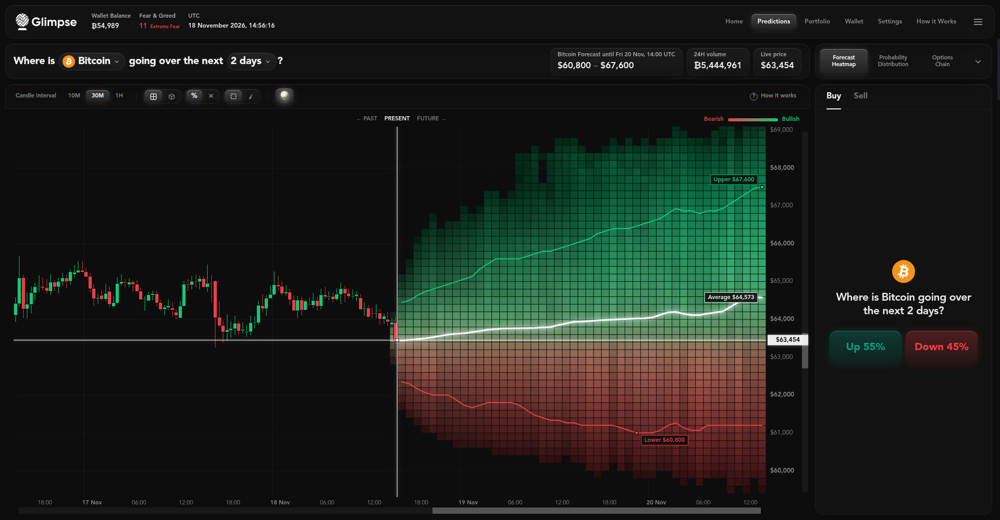
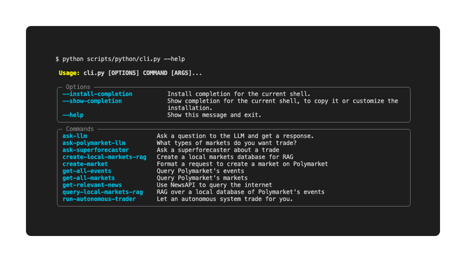
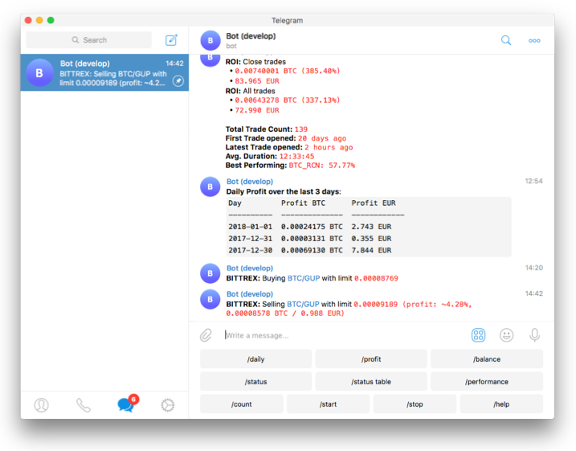
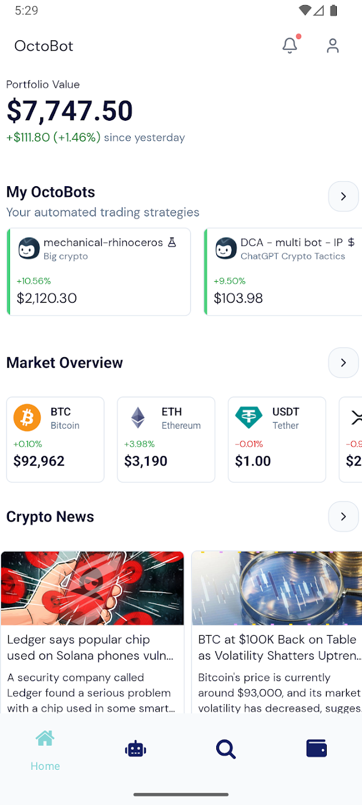
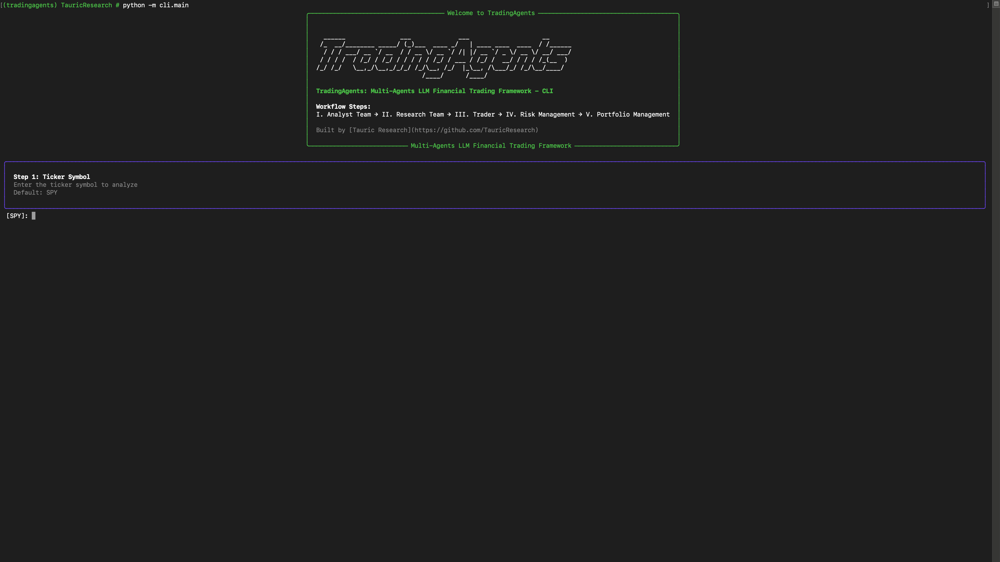
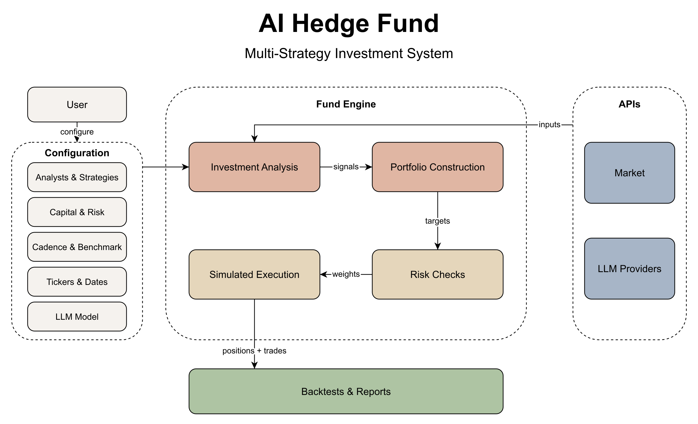

# AI & Algorithmic Trading Bots on GitHub: Full Index

An awesome-list style index of open-source AI and algorithmic trading bot projects on GitHub: crypto trading bots, stock and quant frameworks, prediction-market bots, and LLM/agent-based trading tools. Every GitHub entry below is a real repository verified through GitHub's own repository search on the compile date, with its star count as of that date.

This list is for information only. Use it at your own risk.

## Filter by strategy

Every entry carries strategy tags at the end of its line. To filter the list, search this page for a tag (for example "LLM-agent") and only entries carrying that tag match. Tag vocabulary: rule-based, technical-indicator, grid, DCA, arbitrage, market-making, momentum, mean-reversion, backtesting, ML, reinforcement-learning, LLM-agent, signal, copy-trading, framework.

## Our project

- **Glimpse** (our own project) — Prediction-market trading tool: reads prediction-market batches, wallet balance and portfolio through its API at [main.bpmapi.io](https://main.bpmapi.io). Category: prediction markets. (Listed first by design; not a GitHub entry, so no star count.) Tags: signal.

  
  *Glimpse: the Bitcoin forecast heatmap in the [Glimpse](https://main.bpmapi.io) app (real screenshot from the 2026-11-18 review walkthrough).*

## Contents

- [Prediction markets](#prediction-markets)
- [Crypto](#crypto)
- [Stocks and general quant frameworks](#stocks-and-general-quant-frameworks)
- [LLM agents and machine learning](#llm-agents-and-machine-learning)

## Prediction markets

- [Polymarket/agents](https://github.com/Polymarket/agents) — ⭐ 3,817 — Polymarket's official framework for trading autonomously on Polymarket with AI agents (LLM agent). Tags: LLM-agent, framework.

  
  *Polymarket/agents: the agent CLI, as published in the [Polymarket/agents](https://github.com/Polymarket/agents) docs.*
- [alsk1992/CloddsBot](https://github.com/alsk1992/CloddsBot) — ⭐ 3,119 — Open-source AI trading agent operating autonomously across 1,000+ markets: Polymarket, Kalshi, Binance, Hyperliquid and Solana DEXs (LLM agent). Tags: LLM-agent.
- [warproxxx/poly-maker](https://github.com/warproxxx/poly-maker) — ⭐ 1,532 — Automated market-making bot for Polymarket that provides liquidity on both sides of the order book (rule-based). Tags: market-making, rule-based.
- [ent0n29/polybot](https://github.com/ent0n29/polybot) — ⭐ 1,057 — Reverse-engineered Polymarket strategies and high-frequency trading infrastructure for Polymarket (rule-based/HFT). Tags: rule-based, framework.
- [sterlingcrispin/nothing-ever-happens](https://github.com/sterlingcrispin/nothing-ever-happens) — ⭐ 980 — Polymarket bot that buys "No" on all non-sports markets (rule-based; built for entertainment). Tags: rule-based.
- [suislanchez/polymarket-kalshi-weather-bot](https://github.com/suislanchez/polymarket-kalshi-weather-bot) — ⭐ 840 — Trades weather temperature markets on Kalshi and Polymarket using 31-member GFS ensemble forecasts (quant model). Tags: signal.
- [caiovicentino/polymarket-mcp-server](https://github.com/caiovicentino/polymarket-mcp-server) — ⭐ 753 — MCP server that lets Claude trade Polymarket with 45 tools and real-time monitoring (LLM agent tooling). Tags: LLM-agent, framework.
- [ryanfrigo/kalshi-ai-trading-bot](https://github.com/ryanfrigo/kalshi-ai-trading-bot) — ⭐ 660 — Agent-native toolkit (CLI, MCP server, Claude skill) for finding and measuring edge on Kalshi (LLM agent). Tags: LLM-agent, signal.
- [radioman/polymarket-arbitrage-trading-bot](https://github.com/radioman/polymarket-arbitrage-trading-bot) — ⭐ 650 — Arbitrage bot for BTC and ETH 5-minute Polymarket markets with automated execution and wallet copy trading (rule-based). Tags: arbitrage, copy-trading, rule-based.
- [tarpboi/Prediction-Markets-Trading-Bot-Toolkits](https://github.com/tarpboi/Prediction-Markets-Trading-Bot-Toolkits) — ⭐ 532 — Rust trading bots for Predict.fun, Polymarket, Kalshi and Limitless, led by copy trading (rule-based). Tags: copy-trading, rule-based.
- [OctagonAI/kalshi-trading-bot-cli](https://github.com/OctagonAI/kalshi-trading-bot-cli) — ⭐ 417 — AI-native CLI for Kalshi: fundamental research, independent probability estimates and edge versus the live order book (LLM agent). Tags: LLM-agent, signal.

## Crypto

- [freqtrade/freqtrade](https://github.com/freqtrade/freqtrade) — ⭐ 57,098 — Free, open-source crypto trading bot in Python with backtesting, strategy optimisation and optional ML (rule-based/ML). Tags: rule-based, backtesting, ML.

  
  *Freqtrade: the bot reporting trades and profit over Telegram, as published in the [freqtrade/freqtrade](https://github.com/freqtrade/freqtrade) README.*
- [hummingbot/hummingbot](https://github.com/hummingbot/hummingbot) — ⭐ 21,306 — Framework to create and deploy high-frequency crypto trading bots, market making and arbitrage (rule-based). Tags: market-making, arbitrage, framework.
- [askmike/gekko](https://github.com/askmike/gekko) — ⭐ 10,179 — Pioneering Bitcoin trading bot written in Node.js (rule-based). Tags: rule-based.
- [ccxt/binance-trade-bot](https://github.com/ccxt/binance-trade-bot) — ⭐ 8,834 — Automated cryptocurrency trading bot that tracks altcoins and moves value through a bridge currency (rule-based). Tags: rule-based.
- [jesse-ai/jesse](https://github.com/jesse-ai/jesse) — ⭐ 8,823 — Advanced crypto trading bot framework in Python with backtesting and ML research tooling (rule-based/ML). Tags: framework, backtesting, ML.
- [DeviaVir/zenbot](https://github.com/DeviaVir/zenbot) — ⭐ 8,249 — Command-line cryptocurrency trading bot using Node.js and MongoDB, with genetic-algorithm strategy tuning (rule-based/ML). Tags: rule-based, ML.
- [Drakkar-Software/OctoBot](https://github.com/Drakkar-Software/OctoBot) — ⭐ 6,962 — Open-source crypto bot automating AI, grid, DCA and TradingView strategies across 15+ exchanges (rule-based/AI). Tags: grid, DCA, signal.

  
  *OctoBot: the mobile app dashboard, as published in the [Drakkar-Software/OctoBot](https://github.com/Drakkar-Software/OctoBot) README.*
- [Superalgos/Superalgos](https://github.com/Superalgos/Superalgos) — ⭐ 5,811 — Visually design, backtest and run crypto trading bots on a free, open-source platform (rule-based). Tags: rule-based, backtesting, framework.
- [CryptoSignal/Crypto-Signal](https://github.com/CryptoSignal/Crypto-Signal) — ⭐ 5,660 — Trading and technical-analysis bot that tracks crypto assets and generates signals (rule-based). Tags: signal, technical-indicator.
- [chrisleekr/binance-trading-bot](https://github.com/chrisleekr/binance-trading-bot) — ⭐ 5,614 — Automated Binance trading bot with pluggable strategies, backtesting, a live dashboard and an AI agent connection over MCP (rule-based/LLM agent). Tags: rule-based, backtesting, LLM-agent.
- [nkaz001/hftbacktest](https://github.com/nkaz001/hftbacktest) — ⭐ 5,121 — High-frequency trading and market-making backtesting and live trading bot using full tick data, with Binance and Bybit examples (rule-based/HFT). Tags: market-making, backtesting.
- [ctubio/Krypto-trading-bot](https://github.com/ctubio/Krypto-trading-bot) — ⭐ 3,735 — Self-hosted crypto trading bot for automated high-frequency market making, written in C++ (rule-based/HFT). Tags: market-making.
- [thrasher-corp/gocryptotrader](https://github.com/thrasher-corp/gocryptotrader) — ⭐ 3,467 — Cryptocurrency trading bot and framework supporting multiple exchanges, written in Go (rule-based framework). Tags: framework, rule-based.
- [Open-Trader/opentrader](https://github.com/Open-Trader/opentrader) — ⭐ 2,936 — Open-source crypto trading bot with DCA and grid strategies and a web UI (rule-based). Tags: DCA, grid.
- [scrtlabs/catalyst](https://github.com/scrtlabs/catalyst) — ⭐ 2,559 — Algorithmic trading library for crypto assets in Python, in the Zipline style (rule-based framework). Tags: framework.

## Stocks and general quant frameworks

- [vnpy/vnpy](https://github.com/vnpy/vnpy) — ⭐ 46,437 — Python open-source quantitative trading platform framework (VeighNa) for stocks, futures, options and crypto (general framework). Tags: framework.
- [nautechsystems/nautilus_trader](https://github.com/nautechsystems/nautilus_trader) — ⭐ 31,702 — Production-grade, Rust-native, event-driven trading engine for backtesting and live multi-asset trading (general framework). Tags: framework, backtesting.
- [mementum/backtrader](https://github.com/mementum/backtrader) — ⭐ 23,764 — Python backtesting library for trading strategies, widely used to build stock and crypto bots (general framework). Tags: backtesting, framework.
- [QuantConnect/Lean](https://github.com/QuantConnect/Lean) — ⭐ 22,630 — Lean algorithmic trading engine by QuantConnect (Python, C#) for equities, forex, options and crypto (general framework). Tags: framework.
- [quantopian/zipline](https://github.com/quantopian/zipline) — ⭐ 20,257 — Zipline, a Pythonic algorithmic trading library for US equities backtesting (general framework). Tags: backtesting, framework.
- [StockSharp/StockSharp](https://github.com/StockSharp/StockSharp) — ⭐ 11,136 — Open-source algorithmic and quantitative trading platform to develop trading robots for stock markets, forex, crypto and options (general framework). Tags: framework.
- [kernc/backtesting.py](https://github.com/kernc/backtesting.py) — ⭐ 9,267 — Lightweight Python library to backtest trading strategies on historical data (general framework). Tags: backtesting, framework.
- [ricequant/rqalpha](https://github.com/ricequant/rqalpha) — ⭐ 6,889 — Extendable Python algorithmic backtest and trading framework supporting multiple securities, focused on China markets (general framework). Tags: backtesting, framework.
- [maxbbraun/trump2cash](https://github.com/maxbbraun/trump2cash) — ⭐ 6,550 — Stock trading bot powered by Trump tweets: sentiment analysis of posts triggers trades (rule-based/sentiment). Tags: signal, rule-based.
- [wondertrader/wondertrader](https://github.com/wondertrader/wondertrader) — ⭐ 6,452 — WonderTrader, a one-stop quantitative research and trading framework (general framework). Tags: framework.
- [gbeced/pyalgotrade](https://github.com/gbeced/pyalgotrade) — ⭐ 4,679 — Python algorithmic trading library for backtesting and live trading (general framework). Tags: backtesting, framework.
- [fasiondog/hikyuu](https://github.com/fasiondog/hikyuu) — ⭐ 3,733 — High-performance quantitative trading framework in C++/Python focused on strategy analysis and backtesting (general framework). Tags: backtesting, framework.
- [edtechre/pybroker](https://github.com/edtechre/pybroker) — ⭐ 3,724 — Algorithmic trading in Python with machine learning: train and backtest ML-based strategies (ML framework). Tags: ML, backtesting.
- [blankly-finance/blankly](https://github.com/blankly-finance/blankly) — ⭐ 2,485 — Build, backtest and deploy trading algorithms in a few lines of code across stocks, crypto and forex (general framework). Tags: backtesting, framework.
- [coding-kitties/investing-algorithm-framework](https://github.com/coding-kitties/investing-algorithm-framework) — ⭐ 2,251 — Framework for developing, backtesting and deploying automated trading algorithms and bots (general framework). Tags: backtesting, framework.
- [Lumiwealth/lumibot](https://github.com/Lumiwealth/lumibot) — ⭐ 2,242 — Python trading framework with AI agents that place trades; backtest, paper and live trading on 12 brokers across stocks, options, futures, forex and crypto (general framework/LLM agent). Tags: framework, backtesting, LLM-agent.

## LLM agents and machine learning

- [TauricResearch/TradingAgents](https://github.com/TauricResearch/TradingAgents) — ⭐ 123,249 — TradingAgents: a multi-agent LLM financial trading framework where analyst, researcher and trader agents debate and decide (LLM agent). Tags: LLM-agent, framework.

  
  *TradingAgents: the multi-agent CLI at startup, as published in the [TauricResearch/TradingAgents](https://github.com/TauricResearch/TradingAgents) README.*
- [virattt/ai-hedge-fund](https://github.com/virattt/ai-hedge-fund) — ⭐ 64,774 — An AI hedge fund team: LLM agents modelled on famous investors analyse stocks and make portfolio decisions (LLM agent). Tags: LLM-agent.

  
  *AI Hedge Fund: the system overview published in the [virattt/ai-hedge-fund](https://github.com/virattt/ai-hedge-fund) README.*
- [microsoft/qlib](https://github.com/microsoft/qlib) — ⭐ 50,448 — Qlib, Microsoft's AI-oriented quant investment platform, from ML research to production trading (ML). Tags: ML, framework.
- [hsliuping/TradingAgents-CN](https://github.com/hsliuping/TradingAgents-CN) — ⭐ 33,022 — Chinese enhanced edition of TradingAgents: a multi-agent LLM financial trading framework for China markets (LLM agent). Tags: LLM-agent, framework.
- [HKUDS/AI-Trader](https://github.com/HKUDS/AI-Trader) — ⭐ 23,338 — AI-Trader: a 100% fully automated, agent-native trading system (LLM agent). Tags: LLM-agent.
- [AI4Finance-Foundation/FinGPT](https://github.com/AI4Finance-Foundation/FinGPT) — ⭐ 21,597 — FinGPT: open-source financial large language models, used for sentiment and signal generation in trading pipelines (LLM). Tags: signal.
- [AI4Finance-Foundation/FinRL](https://github.com/AI4Finance-Foundation/FinRL) — ⭐ 17,152 — FinRL: a financial reinforcement learning library for training trading agents on stocks and crypto (ML/RL). Tags: reinforcement-learning, ML, framework.
- [OpenByteInc/QuantDinger](https://github.com/OpenByteInc/QuantDinger) — ⭐ 13,886 — Self-hosted agentic trading OS: AI research, Python strategies, factor discovery, backtesting and paper/live multi-asset trading (LLM agent). Tags: LLM-agent, backtesting.
- [TraderAlice/OpenAlice](https://github.com/TraderAlice/OpenAlice) — ⭐ 7,475 — An AI trading agent covering equities, crypto, commodities, forex and macro, from research through position management (LLM agent). Tags: LLM-agent.
- [tensortrade-org/tensortrade](https://github.com/tensortrade-org/tensortrade) — ⭐ 7,272 — Open-source reinforcement learning framework for training, evaluating and deploying trading agents (ML/RL). Tags: reinforcement-learning, framework.
- [The-Swarm-Corporation/AutoHedge](https://github.com/The-Swarm-Corporation/AutoHedge) — ⭐ 6,714 — Build an autonomous hedge fund with swarm intelligence and AI agents for analysis, risk management and execution (LLM agent). Tags: LLM-agent.
- [wquguru/nof0](https://github.com/wquguru/nof0) — ⭐ 2,752 — Open-source AI trading arena: a reproduction of the NOF1 Alpha Arena for running and comparing LLM trading agents (LLM agent). Tags: LLM-agent, framework.
- [51bitquant/ai-hedge-fund-crypto](https://github.com/51bitquant/ai-hedge-fund-crypto) — ⭐ 630 — AI hedge fund for cryptocurrency trading, using LLM agents for decision-making (LLM agent). Tags: LLM-agent.

---

*Compiled 2026-11-20. Star counts are as of 2026-11-20, retrieved via GitHub's repository search; counts change daily. Glimpse is our own project and is listed first by design. Research only: no repository was starred, followed or otherwise interacted with while compiling this list.*
